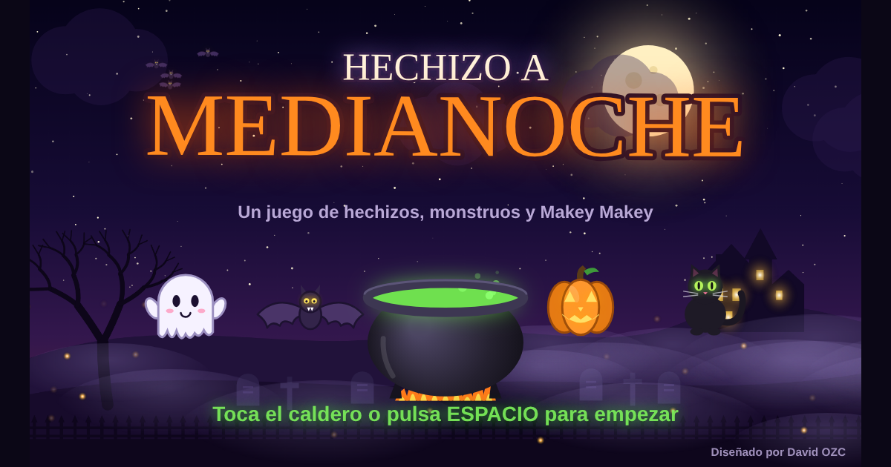

# Hechizo a Medianoche

Juego de Halloween para el aula, pensado para jugar con **Makey Makey**, teclado o pantalla táctil.

**Jugar:** https://dortcal.github.io/hechizo-medianoche/

## Cómo se juega

Cuatro monstruos avanzan hacia el caldero y cada uno trae una respuesta. Hay que tocar el monstruo que lleva la respuesta correcta antes de que llegue.

| Tecla (Makey Makey) | Qué hace |
| --- | --- |
| Flecha izquierda | Fantasma |
| Flecha derecha | Calabaza |
| Flecha arriba | Murciélago |
| Flecha abajo | Gato |
| Espacio | Caldero: superhechizo y confirmar en los menús |
| Esc | Pausa (y volver al menú con la flecha izquierda) |

Retos: tablas de multiplicar, sumas y restas, patrones y secuencias, ortografía e inglés, cada uno con tres niveles. Al final de cada partida aparece el jefe final y un salón de la fama por equipos.

**Antes de jugar:** haz clic una vez dentro del juego para que reciba las teclas de la Makey Makey.

## En móviles y tabletas

- El juego ocupa toda la pantalla y se juega en horizontal. Si el dispositivo está en vertical, pide girarlo.
- En Android y en iPad entra en pantalla completa al primer toque.
- En iPhone, Safari no permite la pantalla completa en páginas web: usa **Compartir → Añadir a pantalla de inicio** y ábrelo desde el icono para jugar sin barras del navegador.
- El botón de pausa (arriba a la derecha) permite seguir o salir al menú tocando la pantalla.

## Licencia

Hechizo a Medianoche © 2026 David OZC. Esta obra está bajo una licencia [Creative Commons Reconocimiento-NoComercial-SinObraDerivada 4.0 Internacional (CC BY-NC-ND 4.0)](https://creativecommons.org/licenses/by-nc-nd/4.0/deed.es): puedes usarla y compartirla gratis citando la autoría, sin fines comerciales y sin distribuir versiones modificadas.

**Uso gratuito en centros educativos.** Detalles y créditos de terceros en [LICENSE.md](LICENSE.md).

---

Diseñado por David OZC.
